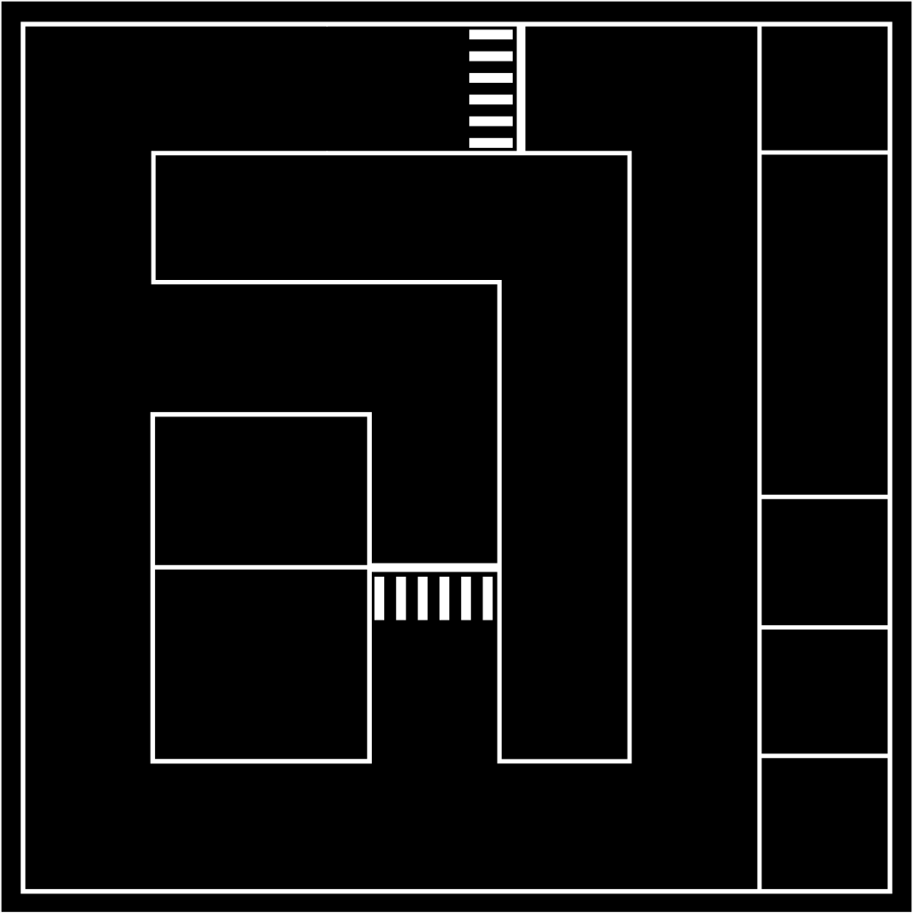

# 智慧社区仿真（Smart Community Simulation）

基于 **ROS Noetic + Gazebo Classic** 的智慧社区自动驾驶仿真工程。小车在社区场地内自主导航，依次完成：

- 红绿灯路口停车等待，绿灯后通行；
- 在社区识别点统计人数，并区分「社区人员 / 非社区人员」；
- 识别社区内部车辆的中文车牌；
- 按路点自动巡航并返回起点。

> 这是一个**系统集成与场景演示**工程，不是训练框架。默认全部使用官方预训练模型，仓库里**没有训练脚本**；如果你的场景需要专用模型，见 [模型训练与微调](#模型训练与微调)。



---

## 目录

- [功能概览](#功能概览)
- [系统架构](#系统架构)
- [目录结构](#目录结构)
- [环境与依赖](#环境与依赖)
- [编译](#编译)
- [模型权重](#模型权重)
- [快速开始](#快速开始)
- [任务流程与路点](#任务流程与路点)
- [感知模块](#感知模块)
- [模型训练与微调](#模型训练与微调)
- [调参与性能](#调参与性能)
- [ROS 接口](#ros-接口)
- [常见问题](#常见问题)
- [已知限制](#已知限制)
- [二次开发](#二次开发)
- [致谢与许可](#致谢与许可)

---

## 功能概览

| 模块 | 实现 | 说明 |
| --- | --- | --- |
| 仿真场景 | Gazebo Classic + `com_sim` | 约 4.2 m × 4.2 m 社区场地，两条街区、人物立牌、车辆车牌、两个红绿灯 |
| 移动底盘 | `urdf_gazebo` | 差速小车，0.30 m × 0.20 m，轮距 0.23 m |
| 传感器 | Gazebo 插件 | 1280×720 @30 Hz 相机；360 线激光雷达 @5.5 Hz |
| 定位建图 | AMCL / gmapping | 已有地图 `nav_demo/mymap/nav.pgm`，也可重新建图 |
| 路径规划 | `move_base` + DWA | 全局/局部代价地图，激光话题使用 `scan_filtered` |
| 任务调度 | `nav_demo/scripts/auto_nav.py` | 按 `waypoint.yaml` 巡航，按路点类型触发视觉任务 |
| 人数统计 | YOLOv8n | COCO `person` 类，零训练 |
| 社区人员识别 | YOLOv8n + OSNet ReID | 检测人 → 提取 512 维外观特征 → 与图库比对余弦相似度 |
| 车牌识别 | HyperLPR3 | 中文蓝牌/绿牌等，零训练 |
| 红绿灯识别 | YOLOv8n + HSV 颜色判定 | 检测灯框后在框内找亮色像素；灯色由 Gazebo 插件循环切换 |
| 激光降噪 | `jie_ware/lidar_filter_node` | 输出 `scan_filtered` 给代价地图 |

---

## 系统架构

```text
                    ┌──────────────────────────────┐
                    │        Gazebo Classic        │
                    │  com.world + 红绿灯插件       │
                    │  /camera/image_raw  /scan    │
                    └──────────────┬───────────────┘
                                   │
              ┌────────────────────┴────────────────────┐
              │                                         │
        /camera/image_raw                            /scan
              │                                         │
              ▼                                         ▼
   ┌─────────────────────┐                    ┌──────────────────┐
   │  vision_node.py     │                    │ lidar_filter_node│
   │  YOLOv8n            │                    │  /scan_filtered  │
   │  HyperLPR3          │                    └────────┬─────────┘
   │  OSNet ReID         │                             │
   └──────┬──────────────┘                             ▼
          │                                   ┌──────────────────┐
          │ /vision/*                         │    move_base     │
          │                                   │  global/local    │
          ▼                                   │    costmap       │
   ┌─────────────────────┐                    └────────┬─────────┘
   │  auto_nav.py        │◄──── /amcl_pose /odom ──────┤
   │  路点任务调度        │                             │
   │  调用视觉服务        │──── /cmd_vel ───────────────┘
   └─────────────────────┘
          ▲
          │ /vision_start /vision_stop /vision_wait_green
          │
   ┌──────┴──────────────┐
   │ map_server + AMCL   │
   │ nav.pgm / nav.yaml  │
   └─────────────────────┘
```

`person_reid/reid.launch` 是**独立**的 ReID 演示节点；主任务流程里 ReID 已经集成进 `vision_node.py`，正常跑导航时**不需要**再启动它。

---

## 目录结构

```text
comrobot_ws/
├── README.md
├── src/
│   ├── com_sim/                     # 社区仿真场景
│   │   ├── launch/
│   │   │   ├── com_sim.launch       # 只启动 Gazebo 世界
│   │   │   ├── bringup.launch       # 世界 + 小车 + 导航 + 视觉（主入口）
│   │   │   └── bringup_slam.launch  # 世界 + 小车（建图用）
│   │   ├── models/                  # 地面、人物立牌、车牌、红绿灯
│   │   └── world/com.world          # 场景装配
│   ├── urdf_gazebo/                 # 小车 URDF/Xacro 与 Gazebo 传感器、驱动插件
│   ├── urdf01_rviz/                 # 仅 RViz 显示用的 URDF
│   ├── nav_demo/                    # 导航、任务调度、视觉识别
│   │   ├── launch/                  # nav01 ~ nav07 各阶段 launch
│   │   ├── param/                   # move_base / 代价地图 / 路点参数
│   │   ├── mymap/                   # 地图 nav.pgm + nav.yaml
│   │   └── scripts/
│   │       ├── auto_nav.py          # 自动巡航 + 任务调度
│   │       └── vision_node.py       # 人数/红绿灯/车牌/社区人员识别
│   ├── person_reid/                 # 独立 ReID 包（建库、标定、ROS 节点）
│   │   ├── gallery/                 # 参考图 + gallery.npz
│   │   ├── neg_ref/                 # 非社区人员参考图（只用于标定）
│   │   ├── models/                  # yolov8n.pt / osnet_x1_0_msmt17.pth
│   │   ├── scripts/                 # reid_engine / build_gallery / calibrate ...
│   │   └── launch/reid.launch
│   ├── yolo_perception/             # 三个独立 YOLO 演示节点（未接入主流程）
│   ├── traffic_light_plugin/        # Gazebo 红绿灯循环变色插件
│   └── jie_ware/                    # 第三方激光定位/降噪/代价地图工具
├── build/  devel/                   # catkin 产物（不入库）
└── .vscode/tasks.json               # catkin_make 任务
```

---

## 环境与依赖

### 实测环境

| 项目 | 版本 |
| --- | --- |
| Ubuntu | 20.04.6 LTS |
| ROS | Noetic |
| Gazebo | Classic 11 |
| Python | 3.8.10 |
| PyTorch | 2.4.1（CPU/GPU 均可） |
| torchvision | 0.19.1 |
| Ultralytics | 8.3.20 |
| HyperLPR3 | 0.1.3 |
| OpenCV | 4.13.0 |
| NumPy | 1.24.4 |
| Pillow | 10.4.0 |

> `ultralytics 8.3.20` 会提示「建议 Python >= 3.10」。在 ROS Noetic 的 Python 3.8 上实测可以运行，这条是警告，不影响。不要为了消警告随意升级系统 Python，否则 `cv_bridge` 等 ROS Python 包可能对不上。

### 安装 ROS 与系统依赖

```bash
sudo apt update
sudo apt install -y \
  ros-noetic-desktop-full \
  ros-noetic-gazebo-ros ros-noetic-gazebo-plugins ros-noetic-gazebo-ros-control \
  ros-noetic-gazebo-dev \
  ros-noetic-amcl ros-noetic-move-base ros-noetic-map-server ros-noetic-gmapping \
  ros-noetic-joint-state-publisher ros-noetic-robot-state-publisher ros-noetic-rviz \
  ros-noetic-cv-bridge ros-noetic-image-view ros-noetic-teleop-twist-keyboard \
  fonts-wqy-zenhei
```

中文标注依赖 CJK 字体。`fonts-wqy-zenhei` 装不上时，也可以装 `fonts-noto-cjk` 或 `fonts-wqy-microhei`；`vision_node.py` 和 `reid_engine.py` 会按固定路径依次查找。

### 安装 Python 依赖

```bash
# 有 NVIDIA GPU（以 CUDA 12.1 为例）
pip3 install torch==2.4.1 torchvision==0.19.1 \
  --index-url https://download.pytorch.org/whl/cu121

# 或者纯 CPU 版本
pip3 install torch==2.4.1 torchvision==0.19.1 \
  --index-url https://download.pytorch.org/whl/cpu

pip3 install ultralytics==8.3.20 hyperlpr3==0.1.3 numpy==1.24.4 pillow
```

`hyperlpr3` 会自动带上 `onnxruntime`、`opencv-python` 等依赖。若系统已经用 apt 安装了 `python3-opencv`，可以不重复装 pip 版；只要 `cv2` 能正常 `import` 即可。

---

## 编译

```bash
cd ~/comrobot_ws
source /opt/ros/noetic/setup.bash
catkin_make
source devel/setup.bash
```

`traffic_light_plugin` 是 C++ Gazebo 插件，必须编译成功才会有 `devel/lib/libtraffic_light_plugin.so`。`person_reid` 的 CMakeLists 里有 `catkin_install_python`（用于 `catkin_make install`）；在 devel 工作空间里，`roslaunch` / `rosrun` 也是直接从源码目录找可执行脚本。`nav_demo` 同样。所以改 Python 代码后重启节点即可，一般不需要重新 `catkin_make`；只有改 C++ 插件才需要重新编译。

VS Code 里可以直接运行 `.vscode/tasks.json` 里的 `catkin_make:debug` 任务。

---

## 模型权重

> **重要：`*.pt` / `*.pth` 已被 `.gitignore` 忽略，新克隆的仓库里没有权重，需要自己放置。** `gallery.npz` 是入库的，但如果你换了 ReID 权重，也必须重新建库。

| 模型 | 用途 | 默认路径 | 来源 | 需要训练吗 |
| --- | --- | --- | --- | --- |
| `yolov8n.pt` | 人 / 红绿灯检测 | `src/person_reid/models/yolov8n.pt` | Ultralytics COCO 预训练 | 否 |
| `osnet_x1_0_msmt17.pth` | 人员 ReID 特征提取 | `src/person_reid/models/osnet_x1_0_msmt17.pth` | torchreid OSNet（MSMT17，4101 类） | 否 |
| HyperLPR3 ONNX | 中文车牌检测/识别 | `~/.hyperlpr3/20230229/onnx/` | HyperLPR3 官方 | 否 |
| `gallery.npz` | 社区人员特征库 | `src/person_reid/gallery/gallery.npz` | `build_gallery.py` | 建库，不是训练 |

### 1. YOLOv8n

```bash
mkdir -p src/person_reid/models
cd src/person_reid/models
python3 -c "from ultralytics import YOLO; YOLO('yolov8n.pt')"
```

首次运行会自动从 GitHub 下载到当前目录。国内网络访问 GitHub 不稳定时，手动下载 `yolov8n.pt`（约 6.3 MB）后放到 `src/person_reid/models/`。代码会按以下顺序查找：

- 当前工作目录
- `src/person_reid/models/`
- `~/.ros/`
- `~/models/`

### 2. OSNet ReID 权重

到 torchreid 的模型库下载 `osnet_x1_0_msmt17.pth`（约 17 MB），放到：

```text
src/person_reid/models/osnet_x1_0_msmt17.pth
```

官方权重的下载地址在 Google Drive 上，国内可能无法访问。可以走 HuggingFace 镜像（`hf-mirror.com`）搜索同名权重，或者从已经下载好的机器上直接拷贝。放好后用自检脚本验证：

```bash
python3 src/person_reid/scripts/selftest.py
```

自检会检查依赖、权重、OSNet 结构（`strict=True` 加载）、YOLO 人检测、特征判别力和「建库 → 标定 → 识别」全流程。全部通过时退出码为 0，最后一行是 `结果: 全部 N 项通过 —— 系统可以用了`；有失败项则退出码非 0，并列出失败项。

### 3. HyperLPR3 模型

首次实例化 `lpr3.LicensePlateCatcher()` 时会自动下载并解压到 `~/.hyperlpr3/20230229/`。如果下载失败，可以手动准备：

```text
~/.hyperlpr3/20230229/onnx/
├── y5fu_320x_sim.onnx
├── y5fu_640x_sim.onnx
├── rpv3_mdict_160_r3.onnx
└── litemodel_cls_96x_r1.onnx
```

### 4. ReID 参考图库

```bash
cd src/person_reid
python3 scripts/build_gallery.py --src gallery --out gallery/gallery.npz --threads 2
```

图库的组织方式、命名规则和自检说明见 [person_reid/gallery/README.md](src/person_reid/gallery/README.md)。

---

## 快速开始

```bash
cd ~/comrobot_ws
source devel/setup.bash
roslaunch com_sim bringup.launch
```

这个 launch 会依次启动：

1. Gazebo 世界 `com.world`（含社区地面、立牌、车牌、红绿灯）；
2. 在 `(1.7, 1.7, yaw=π)` 生成小车；
3. `map_server` 加载 `nav_demo/mymap/nav.yaml`；
4. `AMCL` + `move_base`；
5. `auto_nav.py`（自动巡航与任务调度）；
6. `vision_node.py`（YOLO / ReID / 车牌 / 红绿灯）；
7. `lidar_filter_node`（发布 `scan_filtered`）。

首次启动会加载 PyTorch 和三个模型，CPU 上通常需要十几秒到几十秒，等终端出现：

```text
视觉识别节点已启动, 等待指令...
move_base 已连接
```

再按提示开始。由 `roslaunch` 启动时通常没有交互终端，`auto_nav.py` 捕获 `EOFError` 后会自动开始；单独用 `rosrun` 调试时，需要手动传路点文件（否则会去找 `~/waypoints.yaml`）：

```bash
rosrun nav_demo auto_nav.py _auto_start:=true \
  _waypoints_file:=$(rospack find nav_demo)/param/waypoint.yaml
```

单独 `rosrun` 时如果没有启动 `vision_node`，脚本等待视觉服务 60 秒后会警告「只导航、不做识别任务」，导航部分仍然可用。

### 其它入口

| 命令 | 作用 |
| --- | --- |
| `roslaunch com_sim com_sim.launch` | 只启动 Gazebo 社区场景 |
| `roslaunch com_sim bringup_slam.launch` | 场景 + 小车，不启动导航，适合手动建图 |
| `roslaunch urdf_gazebo car.launch` | 空世界 + 小车模型 |
| `roslaunch nav_demo nav06_test.launch` | 已有地图上的完整导航 + 视觉（不含 Gazebo） |
| `roslaunch person_reid reid.launch` | 独立的 ReID 演示节点 |
| `python3 src/yolo_perception/src/count_node.py` | 独立人数统计演示 |
| `python3 src/yolo_perception/src/light_node.py` | 独立红绿灯演示（会直接发 `/cmd_vel`） |
| `python3 src/yolo_perception/src/plate_node.py` | 独立车牌演示 |

`yolo_perception` 里的三个脚本是早期独立演示，订阅的是 `/usb_cam/image_raw`，和当前 Gazebo 相机话题 `/camera/image_raw` 不一致。直接运行时要重映射：

```bash
python3 src/yolo_perception/src/count_node.py /usb_cam/image_raw:=/camera/image_raw
```

`light_node.py` 会直接向 `/cmd_vel` 发速度指令，**不要和 `auto_nav.py` 同时运行**，否则两边会抢车。

### 建图流程（可选）

已有地图可以直接用；如果要重新建图：

```bash
# 终端 1：场景 + 小车
roslaunch com_sim bringup_slam.launch

# 终端 2：gmapping + RViz
roslaunch nav_demo nav01.launch

# 终端 3：手动控制小车走遍场地
rosrun teleop_twist_keyboard teleop_twist_keyboard.py

# 终端 4：保存地图到 src/nav_demo/mymap/nav.pgm / nav.yaml
roslaunch nav_demo nav02_map_save.launch
```

保存后检查 `nav.yaml` 里的 `image` 路径。当前仓库里的 `nav.yaml` 写的是绝对路径：

```yaml
image: /home/hh/comrobot_ws/src/nav_demo/mymap/nav.pgm
```

换机器或换工作空间路径时，改成自己的路径，或者改成相对于 YAML 文件的 `nav.pgm`。

---

## 任务流程与路点

主任务由 `src/nav_demo/param/waypoint.yaml` 驱动。当前流程：

1. 起点出发；
2. **红绿灯 1**：停车等绿灯；
3. **1 街区识别点 1/2/3**：统计人数、区分社区/非社区人员；
4. **2 街区识别点 4/5**：识别点 3 和 4 在同一个坐标，靠不同朝向区分；
5. **红绿灯 2**：停车等绿灯；
6. **车牌点 1/2**：识别社区车辆车牌；
7. 返回起点。

| # | 坐标 `(x, y, yaw)` | 任务 |
| --- | --- | --- |
| 1 | `(1.70, 1.70, π)` | 起点 |
| 2 | `(0.80, 1.70, π)` | 红绿灯 1 |
| 3 | `(-1.10, 1.70, 3π/2)` | 识别 1（1 街区） |
| 4 | `(-1.75, 1.70, 3π/2)` | 途经点 |
| 5 | `(-1.75, 1.07, 0)` | 识别 2（1 街区） |
| 6 | `(-1.75, 0.45, 0)` | 途经点 |
| 7 | `(-0.80, 0.45, π/2)` | 识别 3（1 街区） |
| 8 | `(-0.80, 0.45, -π/2)` | 识别 4（2 街区，原地转 180°） |
| 9 | `(-0.06, 0.45, 3π/2)` | 途经点 |
| 10 | `(-0.06, -0.20, π)` | 识别 5（2 街区） |
| 11 | `(-0.06, -0.03, 3π/2)` | 红绿灯 2 |
| 12 | `(-0.06, -1.85, 0)` | 途经点 |
| 13 | `(1.10, -1.75, 0)` | 车牌 1 |
| 14 | `(1.10, -0.68, 0)` | 车牌 2 |
| 15 | `(1.10, 1.70, 0)` | 途经点 |
| 16 | `(1.70, 1.70, π)` | 回到起点 |

> YAML 里的 `yaw` 用弧度：`3.1416 ≈ π`，`4.7124 ≈ 3π/2`，`1.5708 ≈ π/2`。

### 路点是怎么匹配任务的

任务点写在两个地方，**修改时必须同步**：

1. `src/nav_demo/scripts/auto_nav.py` 的 `TASK_POINTS`：决定到点后调用哪种视觉任务；
2. `src/nav_demo/scripts/vision_node.py` 的 `TASK_WAYPOINTS`：视觉节点根据当前位姿判断「现在在哪个识别点」。

匹配规则：

- `auto_nav.py` 优先读 YAML 里的 `task` / `name` 字段；没有就按坐标（容差 0.05 m）和 yaw（容差 0.20 rad）去 `TASK_POINTS` 里找。
- `vision_node.py` 用距离 0.25 m、朝向 0.35 rad 匹配 `TASK_WAYPOINTS`，并取最近的一个。
- 同一个坐标、不同朝向的点（识别 3 / 识别 4）必须用 yaw 区分，否则会匹配错。

### 路点文件的可调项

```yaml
goal_tolerance_xy: 0.10    # 目前仅占位，auto_nav 实际不读取
goal_tolerance_yaw: 0.10   # 目前仅占位，auto_nav 实际不读取
stay_time_at_bc: 3.0       # 识别点停留时长（秒）
```

- 实际到位判定由 `move_base` 的 `xy_goal_tolerance`（0.15 m）和 `auto_nav.py` 的 `rot_deadband` 决定。
- `initial_pose` 可选；不写时默认 `(1.7, 1.7, π)`，和 `env.launch` 的生成位姿一致。
- 新增/修改路点后，记得同时改 `TASK_POINTS` 和 `TASK_WAYPOINTS`。

---

## 感知模块

### `vision_node.py`（主流程使用）

节点名：`vision_recognition`。所有阈值都写在文件顶部的常量区，**不是 ROS 参数**，改完需要重启节点。

#### 按需订阅与限速

这个节点默认不常驻订阅相机：

- 空闲且没人看 `/vision/annotated` 时，退订 `/camera/image_raw`，把 CPU 让给 `move_base` 和 Gazebo；
- 收到 `/vision_start`、`/vision_wait_green`，或有人订阅 `/vision/annotated` 时，自动重新订阅；
- 识别时按 `PROCESS_HZ = 4.0` 限速；
- 等绿灯时按 `GREEN_HZ = 10.0` 限速；
- 空闲转发标注画面按 `VIEW_HZ = 8.0` 限速。

这是 2 核 CPU 上导航不卡的关键。用 `rqt_image_view` 打开 `/vision/annotated` 会保持相机订阅，持续占用 CPU；不需要看画面时关掉。

#### 三种任务

| 任务 | 触发路点 | 行为 | 结果话题 |
| --- | --- | --- | --- |
| `count` | 识别 1~5 | YOLO 检测人；启用 ReID 时同时区分社区/非社区人员 | `/vision/crowd_count`、`/vision/member_count`、`/vision/stranger_count`、`/vision/member_names` |
| `plate` | 车牌 1/2 | HyperLPR3 识别车牌，置信度 ≥ `CONF_PLATE = 0.6` 才输出 | `/vision/plate_text` |
| `traffic_light` | 红绿灯 1/2 | YOLO 找 `traffic light` 框，框内 HSV 判色；找不到框时全图找亮斑兜底 | `/vision/traffic_light_state` |

稳定判据：同一个结果连续 `STABLE_FRAMES = 3` 帧一致才定稿；一次识别最多处理 `MAX_FRAMES = 20` 帧，防止对不准目标时死循环；定稿后自动关闭识别并退订相机。

#### 红绿灯等待

`/vision_wait_green` 是**阻塞服务**：连续 `NEED_GREEN = 5` 帧判定为绿灯才返回成功；超过 `GREEN_TIMEOUT = 30.0` 秒返回失败。`auto_nav.py` 在红绿灯路点会反复调用，直到成功。

#### ReID 降级

如果图库缺失、OSNet 权重缺失或 `reid_engine` 导入失败，`vision_node` 不会崩溃，而是退回「只数人」模式：`total` 仍然输出，`member` / `stranger` 为 0，`auto_nav` 会打印「未启用社区人员识别」。

### `person_reid`（独立包）

#### 识别流水线

```text
YOLOv8 检测 person
  → 裁剪人框
  → resize 到 256×128 + ImageNet 归一化
  → OSNet x1.0 提取 512 维特征（可选水平翻转 TTA）
  → L2 归一化
  → 与 gallery.npz 做余弦相似度
  → 最高相似度 ≥ threshold：社区人员（带姓名）；否则：陌生人
```

- 默认权重：`osnet_x1_0_msmt17.pth`（MSMT17，4101 类分类头；推理时只取 512 维特征，分类头不参与）。
- 默认阈值：`0.6`。**这个值只是起点，必须用你自己的数据标定**；本场景中陌生人的最高相似度可能接近甚至超过 0.6。
- `min_person_h = 40`：人框高度小于 40 像素时跳过，因为太小的人像提不出可靠外观。
- `tta_flip = true`：查询侧原图 + 水平镜像各提一次特征再平均，精度更好，耗时约翻倍。

#### 建库

```bash
cd src/person_reid
python3 scripts/build_gallery.py --src gallery --out gallery/gallery.npz --threads 2
```

参考图组织方式（两种可以混用，**人名就是身份标签**）：

```text
gallery/
├── 张三/
│   ├── 正面.jpg
│   └── 侧面.jpg
├── 李四_1.jpg
└── 王五.png
```

- 每个人建议 **3~8 张**不同角度/光照/距离的图；只有 1 张也能建库，但稳定性差。
- 参考图可以是已经裁好的人像，也可以是含人的场景照；默认会先用 YOLO 找最大人框并裁剪，找不到人时退回整图。
- `--save-crops <目录>` 可以把自动裁剪结果存下来人工核对。
- 建库默认启用翻转 TTA（`--no-tta` 可关闭），查询侧 `vision_node` / `reid_node` 也默认启用；两侧保持一致即可。
- 建库结束会打印每个人内部的相似度自检；均值低于 0.6 通常说明「不同的人被标成了同一个名字」或参考图质量太差。

> **图库里只放社区人员。** 非社区人员的参考图放在 `neg_ref/`，只用于阈值标定，不能混进 `gallery/`，否则会被当成社区人员计数。

当前仓库的示例图库是 16 个人、每人 1 张特征。实际使用时建议按上面的标准补图后重建。

#### 标定阈值

准备两份**独立于图库**的数据：

```text
calib/
├── pos/                # 社区人员的其它照片，按姓名分子目录
│   ├── 张三/*.jpg
│   └── 李四/*.jpg
└── neg/                # 非社区人员照片，平铺即可
    ├── 路人1.jpg
    └── 陌生人2.jpg
```

```bash
python3 scripts/calibrate_threshold.py \
  --gallery gallery/gallery.npz \
  --pos calib/pos \
  --neg calib/neg \
  --threads 2
```

脚本会扫描 0.30~0.94 的阈值，输出：

- 社区人员通过率（TPR）；
- 陌生人误放行率（FPR）；
- `TPR - FPR` 最大的推荐阈值；
- 误放行 ≤ 5% 时更保守的阈值。

正负样本建议各 30 张以上，并且**不要使用建库时那几张图**。标定结果写到两个地方：

- 主流程：`vision_node.py` 的 `REID_THRESHOLD`；
- 独立节点：`reid.launch` 的 `threshold:=...`。

#### 独立节点

```bash
roslaunch person_reid reid.launch
# 可选参数
roslaunch person_reid reid.launch \
  image_topic:=/camera/image_raw \
  threshold:=0.72 \
  threads:=1 \
  tta_flip:=true
```

服务：

```bash
rosservice call /reid_identify      # 单次识别，结果在 response.message
rosservice call /reid_reload        # 重新加载图库，不用重启节点
rosservice call /reid_start "data: true"   # 连续识别模式
```

> `/reid_reload` 只属于独立节点 `reid_node.py`。主流程里的 `vision_node.py` 没有热加载服务；改完图库后要重启 `vision_node`。

#### 离线测试

```bash
# 单张图
python3 scripts/reid_engine.py 测试图.jpg \
  --gallery gallery/gallery.npz \
  --threshold 0.72 \
  --save /tmp/reid_out.jpg

# 全流程自检（不需要 ROS / Gazebo）
python3 scripts/selftest.py
```

### 红绿灯插件

`traffic_light_plugin` 是一个 Gazebo Classic 的 `VisualPlugin`，按**仿真时间**循环切换灯色：

```text
绿灯 15 s → 黄灯 3 s → 红灯 10 s → 循环
```

三个灯（红/黄/绿）各自是独立的 SDF `<plugin>`，状态由同一个 `SimTime` 推导，所以会保持同步。修改周期时，要同时改 `traffic_light` 和 `traffic_light_b` 两个模型里**红、黄、绿三个灯**的 `<green_duration>` / `<yellow_duration>` / `<red_duration>`：

```text
src/com_sim/models/traffic_light/model.sdf
src/com_sim/models/traffic_light_b/model.sdf
```

改完重启 Gazebo 即可；插件 `.so` 本身不用重新编译。

识别侧的颜色阈值在 `vision_node.py` 顶部：

- `_HSV_S_MIN = 80`：饱和度下限；
- `_HSV_SPANS`：红/黄/绿的 HSV 范围，红色跨色环两端所以有两段；
- 框内判色 `v_min = 120`，全图兜底 `v_min = 100`；
- 框内最少 15 个亮色像素，全图最少 40 个。

仿真光照或灯色改了之后，先用一帧截图看一下 HSV 值，再调这三个常量。

---

## 模型训练与微调

### 先说结论：默认不需要训练

| 需求 | 需要训练吗 | 本仓库的做法 |
| --- | --- | --- |
| 检测画面里的人 / 人物立牌 | 通常不用 | YOLOv8n COCO `person` 类 |
| 检测红绿灯 | 通常不用 | YOLOv8n COCO `traffic light` 类 + HSV 判色 |
| 判断是不是社区人员 | **不用** | OSNet 预训练特征 + 参考图库 + 余弦相似度 |
| 识别中文车牌 | **不用** | HyperLPR3 官方 ONNX 模型 |
| 识别场景专用新目标（比如特定设备） | 需要 | 用 Ultralytics 微调 YOLOv8，流程见下 |
| 大幅提升特定场景的 ReID 区分度 | 可选 | 用 torchreid 训练/微调 OSNet，见下 |

**仓库内没有 `train.py`。** 下面的训练命令来自 Ultralytics / torchreid 官方 CLI，属于可选的二次开发流程；训练本身建议在带 GPU 的机器或 Colab 上做，本机 2 核 CPU 只适合推理。

### 方案 A：微调 YOLOv8（最常用）

适用场景：

- COCO 的 `person` 检测不到卡通立牌，或者漏检/框不准；
- 想增加新的目标类别；
- 想把 `traffic light` 检测得更稳。

#### 1. 先判断是否真的需要

```bash
python3 src/person_reid/scripts/reid_engine.py 一帧截图.jpg --save /tmp/check.jpg
```

如果终端能稳定打印出 `person` 框，且 `/tmp/check.jpg` 画框正常，就先用 COCO 模型，不急着训练。人物立牌是卡通风格，COCO 可能时好时坏；用不同距离/角度多截几张图确认。

#### 2. 采集数据

```bash
# 终端 1：场景 + 小车
roslaunch com_sim bringup_slam.launch

# 终端 2：录相机话题
rosbag record -O ~/community_frames.bag /camera/image_raw

# 或者用 image_view 直接存图（保存目录看节点输出）
rosrun image_view image_saver image:=/camera/image_raw _save_all:=true
```

也可以手动控制小车走遍场地，在每个识别点、红绿灯前、车牌前各录一段。建议覆盖：

- 不同距离（远/中/近）；
- 不同角度（正面/侧面/斜 45°）；
- 不同光照/阴影位置；
- 红绿灯的红、黄、绿三种状态；
- 人物立牌被部分遮挡的情况。

从 bag 里导出图片：

```bash
mkdir -p ~/datasets/community/images/raw
rosrun image_view extract_images _sec_per_frame:=0.2 image:=/camera/image_raw
```

或者用 OpenCV 脚本读 bag，按固定间隔保存。单场景通常 **300~1000 张** 就够，重点在多样性而不是数量。

#### 3. 标注

用 Label Studio、Roboflow、labelme 等工具画框，导出 **YOLO txt** 格式。类别名要和代码里的字符串一致：

- 人数统计：类别名必须是 `person`；
- 红绿灯：类别名必须是 `traffic light`（中间有空格）；
- 如果确实要改名，必须同步改代码：
  - `vision_node.py` 的 `PERSON_CLASS`；
  - `vision_node.py` `detect_traffic_light()` 里的 `"traffic light"`；
  - `yolo_perception/src/count_node.py` 的 `CLASS_NAME`；
  - `reid_engine.py` 的 `detect_persons()` 里 `classes=[0]`（这里写死了类别 ID 0 作为「人」）。

> 最省事的做法：把立牌标成 `person`，红绿灯标成 `traffic light`，并让 `person` 的类别 ID 为 0（`reid_engine` 写死了 `classes=[0]`）。`traffic light` 的 ID 可以是 1，代码是按类别名匹配的，不要求与 COCO 的 ID 9 一致。`data.yaml` 里的 `names` 顺序必须和 txt 里的 class id 对应。

#### 4. 组织数据集

```text
~/datasets/community/
├── community.yaml
├── images/
│   ├── train/
│   └── val/
└── labels/
    ├── train/
    └── val/
```

`community.yaml`：

```yaml
path: /home/hh/datasets/community
train: images/train
val: images/val

names:
  0: person
  1: traffic light
```

如果只训练一个类别，`names` 里只留对应的一行，并确保 txt 里的 class id 从 0 开始连续。

#### 5. 训练

有 GPU 时：

```bash
yolo detect train \
  model=yolov8n.pt \
  data=/home/hh/datasets/community/community.yaml \
  epochs=100 \
  imgsz=640 \
  batch=8 \
  device=0 \
  workers=4 \
  project=runs/community \
  name=yolov8n_community
```

只有 CPU（2 核，会非常慢，仅建议做小规模验证）：

```bash
yolo detect train \
  model=yolov8n.pt \
  data=/home/hh/datasets/community/community.yaml \
  epochs=30 \
  imgsz=416 \
  batch=4 \
  device=cpu \
  workers=2 \
  freeze=10 \
  project=runs/community \
  name=yolov8n_community_cpu
```

`freeze=10` 冻结主干前 10 层，能明显减少 CPU 训练时间，但精度会略低。真实训练建议用 GPU/Colab；本机 2 核跑 100 轮不现实。

#### 6. 验证

```bash
yolo detect val \
  model=runs/community/yolov8n_community/weights/best.pt \
  data=/home/hh/datasets/community/community.yaml

yolo detect predict \
  model=runs/community/yolov8n_community/weights/best.pt \
  source=/home/hh/datasets/community/images/val \
  save=True
```

重点看 `person` 和 `traffic light` 的 mAP、召回率，以及实际画面里的漏检情况。不要只看 mAP，最好在仿真里跑一遍完整任务。

#### 7. 部署到工程

```bash
cp runs/community/yolov8n_community/weights/best.pt \
   src/person_reid/models/community_yolov8n.pt
```

然后二选一：

- **主流程**：把 `src/nav_demo/scripts/vision_node.py` 顶部的 `MODEL_PATH` 改成 `"community_yolov8n.pt"`（权重解析器会去 `person_reid/models/` 找）；
- **独立 ReID 节点**：`roslaunch person_reid reid.launch detector:=/绝对路径/community_yolov8n.pt`。

如果想让 `ReIDEngine` 的默认检测器也换掉，改 `src/person_reid/scripts/reid_engine.py` 的 `DEFAULT_DETECTOR`。Python 改动不需要 `catkin_make`，重启节点即可。

> 注意：`vision_node` 的红绿灯逻辑假定模型输出里有名为 `traffic light` 的类别；`reid_engine.detect_persons()` 假定类别 ID 0 是 `person`。换模型时先确认这两点。

### 方案 B：训练 / 微调 OSNet（可选，通常不需要）

本工程的 ReID 是 **gallery-based**：不训练分类器，只把参考图提成特征存起来，查询时比余弦相似度。对「固定几个社区人员」这个任务，增加/更换参考图 + 标定阈值，性价比远高于训练。

只有在以下情况才考虑训练 OSNet：

- 仿真画面（卡通立牌）与 MSMT17 真实行人域差异太大，预训练特征区分度不够；
- 社区人员数量很多，图库检索的精度/速度不够；
- 需要跨摄像头、跨场景的更强泛化。

训练需要额外的 **torchreid**（本仓库只包含 `osnet.py` 的模型定义和推理，不包含训练代码）。大致流程：

1. 准备 Market-1501 格式的数据集：

   ```text
   data/
   └── market1501/
       ├── bounding_box_train/
       │   ├── 0001_c1s1_000001_00.jpg
       │   └── ...
       ├── bounding_box_test/
       └── query/
   ```

   文件名格式为 `<pid>_c<camid>s<seq>_<frame>_<idx>.jpg`，每个人一个 `pid`。

2. 用 torchreid 训练 `osnet_x1_0`（输入保持 256×128）：

   ```bash
   python main.py \
     --config-file configs/im_osnet_x1_0_softmax_256x128_amsgrad.yaml \
     --root /path/to/data \
     --save-dir logs/osnet_x1_0
   ```

   torchreid 对 Python/torch 版本比较敏感，装不上时可以用官方 Docker 或单独的 conda 环境；不要动 ROS 的 Python 环境。

3. 把训练得到的 checkpoint 放到 `src/person_reid/models/`。`osnet.py` 的 `load_pretrained()` 兼容：

   - 直接的 `state_dict`；
   - 包在 `{"state_dict": ...}` 里的 checkpoint；
   - 带 `module.` 前缀的 DataParallel 权重；
   - 分类头类别数与权重不一致时自动从 `classifier.weight` 推断。

4. 用新权重**重新建库**并**重新标定阈值**：

   ```bash
   cd src/person_reid
   python3 scripts/build_gallery.py \
     --src gallery --out gallery/gallery.npz \
     --weights models/你的osnet.pth --threads 2

   python3 scripts/calibrate_threshold.py \
     --gallery gallery/gallery.npz \
     --pos calib/pos --neg calib/neg \
     --weights models/你的osnet.pth --threads 2
   ```

5. 切换 ReID 权重：
   - 主流程的 `vision_node.py` 在 `load_reid()` 里直接构造 `ReIDEngine(...)`，没有单独的权重常量；可以给构造调用加 `weights="你的osnet.pth"`，或者直接改 `reid_engine.py` 的 `DEFAULT_WEIGHTS`；
   - 独立节点用 `roslaunch person_reid reid.launch weights:=/绝对路径/你的osnet.pth`。

**关键：建库和查询必须使用同一套权重。** 换了权重但没重建 `gallery.npz`，相似度就没有意义。

如果只是嫌 CPU 慢，可以换更小的 OSNet 结构（`osnet_x0_75` / `x0_5` / `x0_25`），但必须使用对应结构的预训练权重，并且同样要重建图库、重新标定。

### 方案 C：HyperLPR3 车牌模型

本工程直接调用 `hyperlpr3.LicensePlateCatcher()`，使用官方 ONNX 模型，不做训练。当前仿真车牌是标准蓝牌（例如 `苏W·GT88V`），HyperLPR3 可以直接处理。

如果换成非标准车牌（特殊字体、异形牌、外文牌），HyperLPR3 可能识别不了。可选做法：

- 换用支持该车牌类型的 OCR/检测模型，修改 `vision_node.py` 的 `read_plate()`；
- 用 HyperLPR 官方训练流程重新训练（外部工作，本仓库不含）；
- 如果只是仿真演示，直接改 `src/com_sim/models/cp/materials/textures/cp.png` 里的车牌样式，保持标准中文蓝牌布局，识别率最高。

### 方案 D：红绿灯「训练」

红绿灯不需要神经网络训练：YOLO 负责找灯框，HSV 负责判颜色。要提升效果，调的是：

1. `vision_node.py` 的 `_HSV_SPANS`、`_HSV_S_MIN`、`v_min`、`MIN_PIX`；
2. `CONF_LIGHT`（YOLO 置信度）；
3. `NEED_GREEN`（连续几帧绿灯确认）；
4. SDF 里的 `green_duration` / `yellow_duration` / `red_duration`。

如果灯的外观变化很大（比如换成箭头灯、圆形灯位置不同），才需要按方案 A 微调 YOLO 的 `traffic light` 类。

---

## 调参与性能

### CPU 上的推荐设置

本工程在 2 核 CPU 上验证过。默认配置已经针对 CPU 做过优化：

| 参数 | 位置 | 默认 | 说明 |
| --- | --- | --- | --- |
| `REID_THREADS` | `vision_node.py` | `1` | torch CPU 线程数；2 核机器留 1 核给导航/Gazebo |
| `PROCESS_HZ` | `vision_node.py` | `4.0` | 识别时限速 |
| `GREEN_HZ` | `vision_node.py` | `10.0` | 等绿灯时限速 |
| `VIEW_HZ` | `vision_node.py` | `8.0` | 空闲转发标注画面限速 |
| `MAX_FRAMES` | `vision_node.py` | `20` | 单次识别最大帧数 |
| `STABLE_FRAMES` | `vision_node.py` | `3` | 连续多少帧一致才定稿 |
| `ENABLE_REID` | `vision_node.py` | `True` | 关掉后退回只数人 |
| `REID_THRESHOLD` | `vision_node.py` | `0.6` | 必须标定 |
| `max_vel_x` | `base_local_planner_params.yaml` | `0.45` | 最大线速度 |
| `max_vel_theta` | `base_local_planner_params.yaml` | `1.4` | 最大角速度 |

### 性能建议

- **跑导航时不要同时开 `person_reid/reid.launch`。** 主流程的 `vision_node` 已经包含 ReID；再开一个独立节点等于跑两套 YOLO + OSNet，2 核 CPU 会明显抢导航的算力。
- 不需要区分社区人员时，把 `ENABLE_REID = False`，只保留人数统计，CPU 占用会明显下降。
- 不看标注画面时关掉 `rqt_image_view` / `image_view`；没人订阅 `/vision/annotated` 时节点会自动退订相机。
- Gazebo GUI 和 RViz 同时开很吃 CPU；调试导航时可以只留一个。
- 如果 `move_base` 在窄通道里抖动，优先降 `max_vel_x`，再微调 `inflation_radius` / `cost_scaling_factor`。
- 识别点停留时间太短导致结果不稳定时，调大 `waypoint.yaml` 的 `stay_time_at_bc`，而不是无限提高 `PROCESS_HZ`。

---

## ROS 接口

### 话题

| 节点 | 方向 | 话题 | 类型 | 说明 |
| --- | --- | --- | --- | --- |
| `vision_node` | 订阅 | `/camera/image_raw` | `sensor_msgs/Image` | 按需订阅 |
| `vision_node` | 订阅 | `/amcl_pose` | `PoseWithCovarianceStamped` | 地图位姿，优先使用 |
| `vision_node` | 订阅 | `/odom` | `nav_msgs/Odometry` | 无 AMCL 时兜底 |
| `vision_node` | 发布 | `/vision/result` | `std_msgs/String` | 一次任务的最终结果 |
| `vision_node` | 发布 | `/vision/traffic_light_state` | `std_msgs/String` | `red` / `yellow` / `green` / `none` |
| `vision_node` | 发布 | `/vision/crowd_count` | `std_msgs/Int32` | 总人数 |
| `vision_node` | 发布 | `/vision/plate_text` | `std_msgs/String` | 多块车牌用竖线分隔 |
| `vision_node` | 发布 | `/vision/annotated` | `sensor_msgs/Image` | 标注画面，有人订阅才发布 |
| `vision_node` | 发布 | `/vision/member_count` | `std_msgs/Int32` | 社区人员数 |
| `vision_node` | 发布 | `/vision/stranger_count` | `std_msgs/Int32` | 非社区人员数 |
| `vision_node` | 发布 | `/vision/member_names` | `std_msgs/String` | 社区人员姓名，`、` 分隔 |
| `reid_node` | 订阅 | `/camera/image_raw` | `sensor_msgs/Image` | 独立 ReID 节点 |
| `reid_node` | 发布 | `/reid/annotated` | `sensor_msgs/Image` | 画框 + 中文姓名 |
| `reid_node` | 发布 | `/reid/detections` | `std_msgs/String` | JSON 详情 |
| `reid_node` | 发布 | `/reid/member_present` | `std_msgs/Bool` | 画面里是否有社区人员 |
| `auto_nav` | 发布 | `/cmd_vel` | `geometry_msgs/Twist` | 取消 `move_base` 目标后做原地旋转/停车 |
| `auto_nav` | 发布 | `/initialpose` | `PoseWithCovarianceStamped` | 启动时设置初始位姿 |
| `yolo light_node` | 发布 | `/cmd_vel` | `geometry_msgs/Twist` | 独立演示，谨慎使用 |

### 服务

| 服务 | 类型 | 所属 | 说明 |
| --- | --- | --- | --- |
| `/vision_start` | `std_srvs/SetBool` | `vision_node` | 开/关识别；`true` 时开始处理当前路点任务 |
| `/vision_stop` | `std_srvs/Trigger` | `vision_node` | 立即停止识别并退订相机 |
| `/vision_wait_green` | `std_srvs/Trigger` | `vision_node` | 阻塞等绿灯，成功返回 `green, go`，超时返回 `timeout` |
| `/reid_start` | `std_srvs/SetBool` | `reid_node` | 开/关连续识别 |
| `/reid_identify` | `std_srvs/Trigger` | `reid_node` | 单次识别，结果在 `message` 里 |
| `/reid_reload` | `std_srvs/Trigger` | `reid_node` | 重新加载图库 |

### Action

| Action | 类型 | 说明 |
| --- | --- | --- |
| `/move_base` | `move_base_msgs/MoveBaseAction` | `auto_nav.py` 下发导航目标 |

### 常用调试命令

```bash
rostopic echo /vision/result
rostopic echo /vision/member_names
rostopic echo /vision/plate_text
rostopic echo /reid/detections

rosservice call /vision_start "data: true"
rosservice call /vision_wait_green
rosservice call /vision_stop

rosservice call /reid_identify
rosservice call /reid_reload

rosrun image_view image_view image:=/vision/annotated
rosrun image_view image_view image:=/reid/annotated
```

---

## 常见问题

### 启动后一直提示找不到权重 / 自动下载失败

`*.pt` / `*.pth` 不在仓库里。按 [模型权重](#模型权重) 手动放到 `src/person_reid/models/`。国内网络访问 GitHub / Google Drive 不稳定时，走 HuggingFace 镜像或从别的机器拷贝；代码会优先使用本地文件，不会强制联网。

### `libtraffic_light_plugin.so: cannot open shared object file`

说明插件没编译出来或环境没 source：

```bash
cd ~/comrobot_ws
source /opt/ros/noetic/setup.bash
catkin_make
source devel/setup.bash
```

`com_sim.launch` 已经把 `GAZEBO_PLUGIN_PATH` 指向 `devel/lib`；如果仍报错，确认 `devel/lib/libtraffic_light_plugin.so` 存在。

### 红绿灯在 Gazebo 里不变色

- 确认 `traffic_light_plugin` 编译成功；
- 确认用带 GUI 的 Gazebo 启动（`com_sim.launch` 默认 `gui=true`）；
- 该插件是 `VisualPlugin`，依赖 Gazebo 渲染；纯无界面/服务器模式下的表现未做验证；
- 检查 SDF 里三个灯的 `<plugin filename="libtraffic_light_plugin.so">` 是否还在。

### `图库不存在` / 所有人都显示「陌生人」

```bash
cd src/person_reid
python3 scripts/build_gallery.py --src gallery --out gallery/gallery.npz --threads 2
```

如果图库存在但仍全是陌生人，通常是阈值太高，或者仿真里的人物外观和图库不一致（见 [已知限制](#已知限制)）。先跑 `calibrate_threshold.py`。

### 社区人员误判很多 / 陌生人被认成社区人员

- 默认阈值 `0.6` 偏低，按标定结果调高；
- 确认 `gallery/` 里只有社区人员，非社区参考图放到 `neg_ref/`；
- 每个人补充 3~8 张参考图，避免只用一张；
- 检查 `min_person_h` 是否太小，太小的框提不出可靠特征；
- 如果所有立牌外观完全相同，ReID 无法区分——需要给不同立牌换不同纹理。

### 中文姓名显示成方框/问号

安装 CJK 字体：

```bash
sudo apt install fonts-wqy-zenhei
# 或
sudo apt install fonts-noto-cjk
```

`vision_node.py` 和 `reid_engine.py` 会依次查找文泉驿、Noto、Droid、AR PL 等常见路径。

### `还没收到 /amcl_pose 或 /odom, 无法判断路点`

- 确认启动的是 `bringup.launch`（包含 AMCL），而不是只有 Gazebo；
- 检查 `map -> odom -> base_footprint` 的 TF 是否存在：

  ```bash
  rosrun tf tf_echo map base_footprint
  ```

- 检查初始位姿是否和 Gazebo 生成位置一致（默认 `(1.7, 1.7, π)`）；
- `vision_node` 会优先用 `/amcl_pose`，收不到时才用 `/odom` 兜底。

### 地图加载失败 / 路径不对

`nav_demo/mymap/nav.yaml` 里的 `image` 是绝对路径，换机器后要改成自己的路径或 `nav.pgm`。同时确认 `resolution: 0.05` 和 `origin: [-50, -50, 0]` 没被改掉。

### `move_base` 连不上 / 导航不动

- 先启动 Gazebo 和导航，再启动 `auto_nav.py`；
- 确认 `move_base` 节点在运行：

  ```bash
  rosnode list | grep move_base
  rostopic echo /move_base/status
  ```

- 确认 `/scan_filtered` 有数据：

  ```bash
  rostopic hz /scan_filtered
  ```

  `nav06_test.launch` 会启动 `lidar_filter_node`；如果单独跑 `nav05_path.launch`，需要自己提供 `scan_filtered`。

### 识别/导航都很卡

- 关掉 `person_reid/reid.launch`，主流程不需要它；
- 关掉 `rqt_image_view` / `image_view`；
- `vision_node.py` 里 `REID_THREADS = 1`，不要设成 2；
- 不需要社区人员识别时设 `ENABLE_REID = False`；
- 降低 Gazebo 分辨率/GUI 负担，或只保留 Gazebo 或 RViz 之一。

### `ultralytics` 提示 Python 版本过低

这是警告，不是错误。ROS Noetic 自带 Python 3.8，当前版本可以运行。不要为了消警告去替换系统 Python。

### `hyperlpr3` 首次运行下载很慢/失败

手动准备 `~/.hyperlpr3/20230229/onnx/` 下的四个 ONNX 文件，见 [模型权重](#模型权重)。

### `yolo_perception` 的节点没有画面

它们订阅 `/usb_cam/image_raw`，而 Gazebo 相机发布的是 `/camera/image_raw`。运行时重映射：

```bash
python3 src/yolo_perception/src/count_node.py /usb_cam/image_raw:=/camera/image_raw
```

---

## 已知限制

1. **仿真人物外观重复**：当前 `ro1*` 和 `ro2*` 共 18 个立牌只用了两张**内容相同**的纹理（`rodesign0.png` / `rodesign1.png`），所以场景里所有人的外观几乎一样。ReID 是外观特征匹配，这种情况下无法区分不同人。如果要验证「社区人员 / 陌生人」的区分效果，需要给不同立牌准备不同纹理，并用这些纹理的截图重建图库。
2. **图库与场景不一定对应**：`gallery/` 里是 16 个不同人物的示例图，每人只有 1 张特征；实际使用时请替换成你自己的社区人员参考图（建议每人 3~8 张）。
3. **地图路径写死**：`nav_demo/mymap/nav.yaml` 的 `image` 是绝对路径，迁移工程时要修改。
4. **`goal_tolerance_xy/yaw` 未生效**：`waypoint.yaml` 里的这两个字段目前没有被 `auto_nav.py` 读取。
5. **`yolo_perception` 是独立演示**：没有接入主 launch，话题是 `/usb_cam/image_raw`，脚本也没有可执行位；请用 `python3` 直接运行。
6. **`jie_ware` 的示例 launch 不可直接用**：`amcl_test.launch` / `lidar_loc_test.launch` 依赖 `wpr_simulation` 等未包含的包；本工程只用到 `lidar_filter_node`。
7. **红绿灯插件依赖 Gazebo 渲染**：它是 `VisualPlugin`，无界面模式下的灯色表现未验证。
8. **没有训练脚本**：本仓库只做推理与建库；训练流程见 [模型训练与微调](#模型训练与微调)。
9. **CPU 性能有限**：2 核 CPU 上可以跑完整流程，但不要同时开多套 YOLO/ReID。

---

## 二次开发

### 增加一个识别点

1. 在 `src/nav_demo/param/waypoint.yaml` 里加坐标和 yaw；
2. 在 `src/nav_demo/scripts/auto_nav.py` 的 `TASK_POINTS` 里加同样的坐标、yaw、`task` 和 `name`；
3. 在 `src/nav_demo/scripts/vision_node.py` 的 `TASK_WAYPOINTS` 里加同样的坐标、yaw、`task` 和 `name`；
4. 如果属于新的街区，更新 `auto_nav.py` 的 `street_tally`；
5. 重启 `auto_nav` 和 `vision_node`。

更推荐直接给 YAML 条目加 `task` / `name` 字段，让 `auto_nav` 不依赖坐标匹配；但 `vision_node` 仍然需要 `TASK_WAYPOINTS` 里有对应条目。

### 换地图

1. 用 `nav02_map_save.launch` 保存新地图；
2. 修改 `nav.yaml` 的 `image`、`resolution`、`origin`；
3. 更新路点和 `TASK_POINTS` / `TASK_WAYPOINTS`；
4. 不需要重新编译。

### 增加/替换场景模型

- 在 `src/com_sim/models/` 下新建模型目录（`model.config` + `model.sdf` + mesh/texture）；
- 在 `src/com_sim/world/com.world` 里用 `<include><uri>model://你的模型</uri><pose>...</pose></include>` 装配；
- 红绿灯模型复制 `traffic_light` 目录后，修改 SDF 里的灯色和周期；
- 人物立牌如果要区分身份，给每个模型使用不同纹理；
- 车牌样式直接改 `src/com_sim/models/cp/materials/textures/cp.png`（保持标准中文蓝牌布局识别率最高）。

### 替换检测模型

- 训练流程见 [方案 A](#方案-a微调-yolov8最常用)；
- 权重放到 `src/person_reid/models/`；
- 主流程改 `vision_node.py` 的 `MODEL_PATH`；
- 独立 ReID 节点用 `detector:=` 参数；
- 确认类别名和 `classes=[0]` / `"traffic light"` 的假设仍然成立。

### 替换 ReID 模型

- 训练流程见 [方案 B](#方案-b训练--微调-osnet可选通常不需要)；
- 权重放到 `src/person_reid/models/`；
- 用新权重重建 `gallery.npz` 并重新标定阈值；
- 主流程改 `vision_node.py` 的 `load_reid()` 默认权重路径，或改 `reid.launch` 的 `weights:=`；
- 建库和查询必须使用同一套权重。

### 只做视觉演示

不启动导航，只启动 Gazebo 和视觉：

```bash
roslaunch com_sim bringup_slam.launch
roslaunch person_reid reid.launch
# 或
rosrun nav_demo vision_node.py
```

然后用 `rosservice call /vision_start "data: true"` 或 `/reid_identify` 触发识别。

---

## 致谢与许可

本工程整合了以下开源项目，感谢原作者：

- [jie_ware](https://github.com/6-robot/jie_ware)（阿杰的 ROS 工具箱）：激光定位、代价地图清除、激光降噪。许可证见 [src/jie_ware/LICENSE](src/jie_ware/LICENSE)（GPL）。
- [Ultralytics YOLOv8](https://github.com/ultralytics/ultralytics)：目标检测。Ultralytics 采用 AGPL-3.0，商业使用前请确认许可证。
- [OSNet / torchreid](https://github.com/KaiyangZhou/deep-person-reid)：人员重识别模型与预训练权重。OSNet 论文：Zhou et al., ICCV 2019 / TPAMI 2021。
- [HyperLPR3](https://github.com/szad670401/HyperLPR)：中文车牌识别，Apache-2.0。
- [ROS](https://www.ros.org/) / [Gazebo](https://gazebosim.org/)：机器人中间件与仿真器。

各子包的许可证以其 `package.xml` 和目录下的 `LICENSE` 为准：

- `src/person_reid`：MIT；
- `src/traffic_light_plugin`：BSD；
- `src/jie_ware`：GPL；
- `src/com_sim`、`src/nav_demo`、`src/urdf_gazebo`、`src/urdf01_rviz`、`src/yolo_perception`：见各自 `package.xml`（部分为 TODO，使用前请确认）。

---

## 项目地址

- GitHub：<https://github.com/GGbom-BOOM/smart>

如果这个工程对你有帮助，欢迎 Star；有问题请提 Issue。
